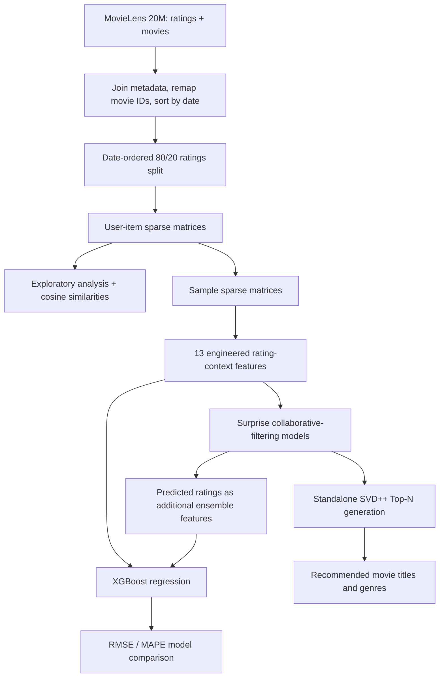

# Movie Recommendation System

**Collaborative filtering · Similarity analysis · Matrix factorization · Gradient boosting · MovieLens 20M**

An end-to-end academic machine learning study of movie-rating prediction and personalized recommendations. The project investigates sparse user–movie interactions, engineers neighborhood-based rating features, compares **11 model configurations**, and produces user-level Top-N recommendations using **SVD++**.

> **Project status:** Completed academic notebook, preserved as originally implemented. This repository documents the original experiment; it is **not** a deployed API or a production recommender. Numerical results below are transcribed from saved notebook outputs and have **not** been independently rerun.

## At a glance

| Area | Original implementation |
| --- | --- |
| Dataset | [MovieLens 20M](https://grouplens.org/datasets/movielens/20m/) (ratings and movie metadata) |
| Data preparation | Movie metadata joins, timestamp transformation, remapped item IDs, date-ordered 80/20 split |
| Representation | SciPy sparse user–item matrices |
| Exploration | Rating distributions, activity over time, user/item behavior, sparsity |
| Similarity | Cosine-based user–user and item–item analysis |
| Feature engineering | Global/user/movie means, five similar-user ratings, five similar-movie ratings |
| Models evaluated | XGBoost, BaselineOnly, user/item KNNBaseline, SlopeOne, SVD, SVD++, and ensemble feature combinations |
| Metrics | RMSE and MAPE |
| Recommendation output | SVD++ scores unrated user–movie pairs and returns Top-10 movie titles/genres |

## Architecture / experiment flow



*Diagram illustrates code paths in the notebook; it is not a deployed software architecture. The original notebook also performs similarity exploration on the full train sparse matrix.*

## Results recorded in the notebook

| Model / configuration | Train RMSE | Test RMSE |
| --- | ---: | ---: |
| XGBoost_13 | 0.8072 | 1.0048 |
| BaselineOnly | 0.8274 | 0.9996 |
| XGB_BSL | 0.8073 | 1.0036 |
| KNNBaseline_User | 0.3378 | 0.9995 |
| KNNBaseline_Item | 0.2742 | 0.9995 |
| XGB_BSL_KNN | 0.8074 | 1.0042 |
| SlopeOne | 0.7606 | 0.9991 |
| SVD | 0.8311 | 0.9995 |
| SVDpp | 0.7631 | 0.9995 |
| XGB_BSL_KNN_MF | 0.8071 | 1.0052 |
| **XGB_KNN_MF_SO** | **1.0665** | **0.9981** |

**Lowest reported test RMSE:** **0.9981**, for `XGB_KNN_MF_SO` in this saved experiment. This is a **rating prediction** metric, not a Top-N recommendation ranking metric. The Top-N demo separately uses SVD++. No Precision@K, Recall@K, NDCG, or online performance figures are claimed.

See [Experiment notes](docs/EXPERIMENTS.md) for the evaluation context and methodological limitations.

## Explore the original work

1. Open [`notebooks/Movie_Recommendation_System.ipynb`](notebooks/Movie_Recommendation_System.ipynb) on GitHub to inspect the original code, plots, saved outputs, and recommendation examples.
2. Read [Technical design](docs/TECHNICAL_DESIGN.md) to follow the data flow and model components.
3. Read [Experiments and limitations](docs/EXPERIMENTS.md) before interpreting reported results.

### Reproducing the historical notebook

The original notebook is **Google Colab-oriented** and uses paths like `/content/ml-20m` along with notebook `!wget`, `!unzip`, and `!pip` commands. It downloads MovieLens 20M at the start; the dataset and intermediate caches are **not** included in this repository. Historical code uses APIs that may no longer be compatible with current pandas, seaborn, XGBoost, or Surprise versions.

To investigate reproducibility, open the notebook in Colab, obtain the [MovieLens 20M archive](https://grouplens.org/datasets/movielens/20m/), and resolve any runtime/library incompatibilities in a separate working copy. **The notebook has not been re-executed as part of this GitHub presentation.** There is intentionally no unverified `requirements.txt` claiming a tested install environment.

## Scope and engineering considerations

- **Sparse interaction modeling:** Explicit ratings represented as sparse user–item matrices.
- **Neighborhood signals:** Both user–user and item–item similarity, with fallbacks for unavailable values.
- **Comparative experimentation:** Multiple collaborative filtering families and feature-augmented regressors evaluated with recorded error metrics.
- **Personalization:** SVD++ estimates missing user–movie ratings and sorts them for Top-N output.
- **Limitations:** Date-ordered *rating-level* splitting is not equivalent to a strictly controlled per-user temporal or cold-start evaluation; sampling is used in the model-building stage; in-sample prediction stacking warrants leakage scrutiny; evaluation focuses on rating prediction, not ranking quality.

### Repository layout

```text
Movie-Recommendation-System/
├── notebooks/
│   └── Movie_Recommendation_System.ipynb  # Original implementation, unmodified
├── docs/
│   ├── TECHNICAL_DESIGN.md                 # Architecture and processing decisions
│   └── EXPERIMENTS.md                      # Saved experimental results and caveats
├── .gitignore
└── README.md
```

**Dataset attribution:** MovieLens data is provided by GroupLens. Consult its [dataset page](https://grouplens.org/datasets/movielens/20m/) for source and usage terms.
